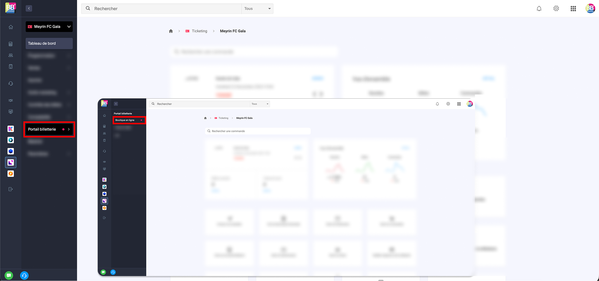
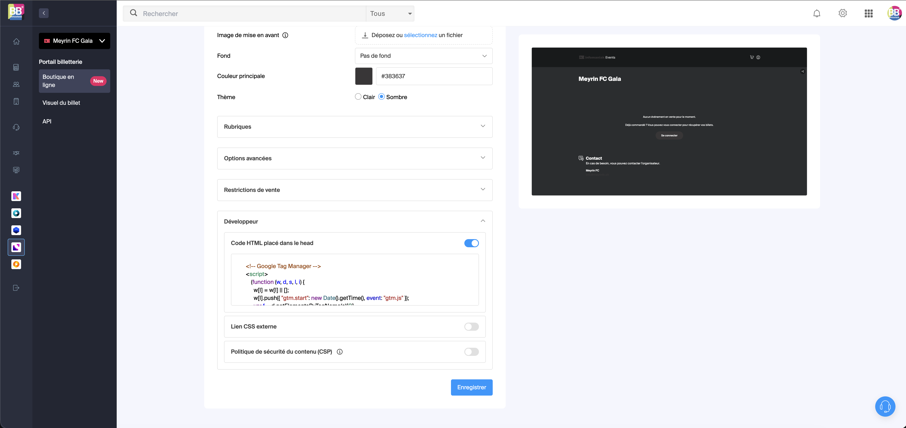
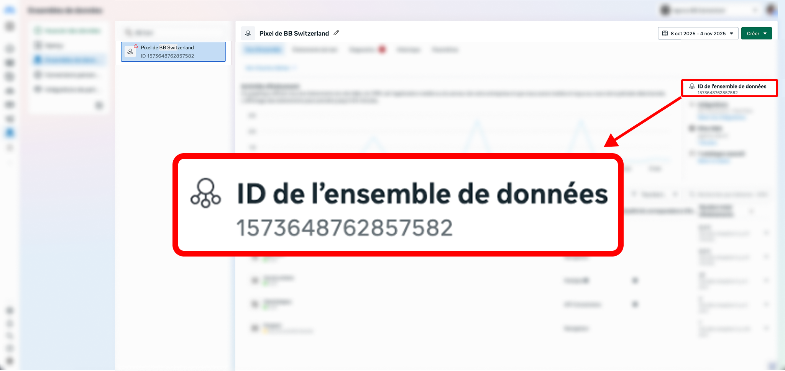
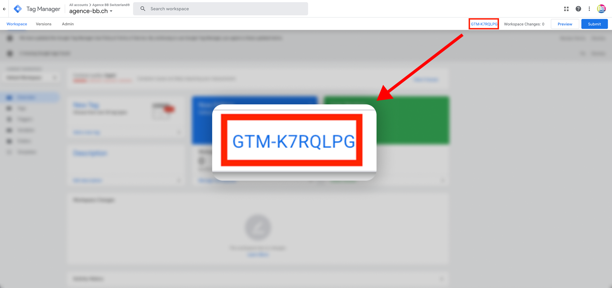
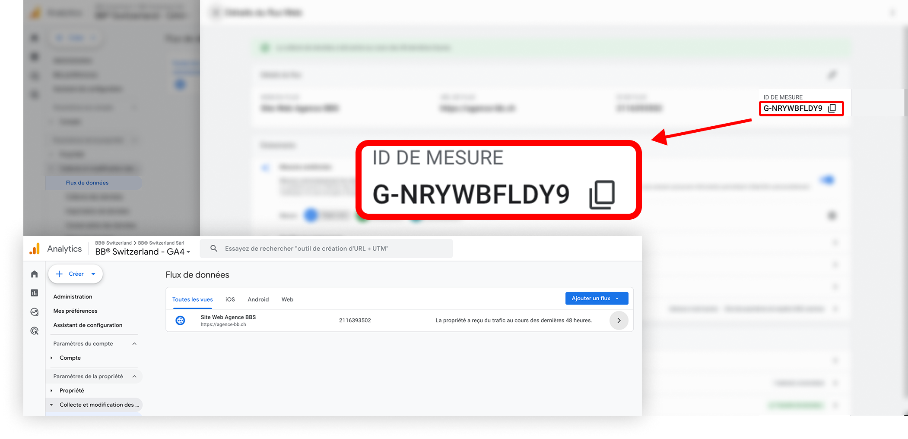

# Tracking Billetterie Infomaniak

:::danger Informations essentielles avant installation

- La billetterie doit **obligatoirement** être une **boutique personnalisée** Infomaniak.
- Les visiteurs doivent accéder à la **URL dédiée** de la boutique (aucune iframe, aucune intégration dans une page externe).
- On ne colle **que le script GTM** dans le head. GA4, Meta, les évènements `ike_` et le consentement sont gérés **dans GTM**.
- Il faut ajouter les **exceptions CSP** pour Meta, sinon le pixel se charge mais **aucun évènement n'arrive chez Meta**.

:::

---

## Checklist d'installation

1. Ticketing > Votre événement > Portail Billetterie > Boutique en ligne
2. Créer une **boutique personnalisée**
3. Ouvrir **Développeur** > **Code HTML placé dans le head** : coller **uniquement** le script GTM
4. Dans **Développeur** > **Politique de sécurité du contenu (CSP)** : ajouter les exceptions Meta
5. Dans GTM : créer les variables, déclencheurs et balises décrits plus bas
6. Tester (Aperçu GTM + Évènements de test Meta), puis **publier** le conteneur





:::warning
Pensez à bien sélectionner votre **évènement** dans l'onglet **Contenu** de la boutique personnalisée pour que votre event soit bien rattaché à la billetterie.
:::

:::tip
Le [configurateur de script](./configurateur) génère le code du head, le script de la balise « Pont ike_* » et la liste des exceptions CSP.
:::

---

## 1. Code à coller dans le head

```html
<script>
  (function (w, d, s, l, i) {
    w[l] = w[l] || [];
    w[l].push({ "gtm.start": new Date().getTime(), event: "gtm.js" });
    var f = d.getElementsByTagName(s)[0],
      j = d.createElement(s),
      dl = l != "dataLayer" ? "&l=" + l : "";
    j.async = true;
    j.src = "https://www.googletagmanager.com/gtm.js?id=" + i + dl;
    f.parentNode.insertBefore(j, f);
  })(window, document, "script", "dataLayer", "GTM-XXXXXXXX");
</script>
```

:::danger Ne rien ajouter d'autre dans le head
- **Pas de `gtag/js` GA4** : si le conteneur a déjà une balise Google GA4, les pages vues sont comptées deux fois.
- **Pas de code pixel Meta (`fbq`)** : il crée des doublons (« Installation manuelle » dans Meta) et se déclenche **sans consentement**.
- **Pas d'écouteurs `ike_` avec `gtag("event", ...)`** : ils doublent les évènements GA4 envoyés par GTM (achats comptés deux fois).
:::

---

## 2. Exceptions CSP (obligatoire pour Meta)

La billetterie Infomaniak applique une politique de sécurité (CSP) qui **bloque l'envoi des données vers Facebook** par défaut. À ajouter dans **Développeur** > **Politique de sécurité du contenu (CSP)** > **Ajouter une exception** :

| Directive | URL |
|---|---|
| `connect-src` | `https://www.facebook.com` |
| `connect-src` | `https://connect.facebook.net` |
| `script-src-elem` | `https://capi-automation.s3.us-east-2.amazonaws.com` |

:::info
- La directive `form-action` n'est pas proposée par Infomaniak. Les deux `connect-src` suffisent pour que les évènements arrivent chez Meta.
- Supprimer toute ligne vide (« Choisir »), sinon le formulaire ne s'enregistre pas.
- Symptômes d'une CSP bloquante dans la console : `violates the following Content Security Policy directive` sur `facebook.com/tr`.
:::

---

## 3. Consentement

Infomaniak affiche son propre bandeau et stocke le choix du visiteur dans le cookie **`googleConsent`** (JSON au format Consent Mode v2). Infomaniak n'envoie une mise à jour du consentement qu'**au moment du clic** sur le bandeau. Pour un visiteur qui revient, il faut donc relire le cookie à chaque page.

### Balise « Billetterie - Consent Mode depuis le bandeau Infomaniak »

- **Type** : HTML personnalisé
- **Déclencheur** : Consent Initialization - All Pages
- **Priorité** : 100
- **Variable requise** : `Cookie - Infomaniak googleConsent` (cookie propriétaire `googleConsent`, décodage URI activé)

```html
<script>
(function () {
  if (location.hostname.indexOf('infomaniak.events') === -1) return;
  var raw = {{Cookie - Infomaniak googleConsent}};
  if (!raw) return;
  var c;
  try { c = JSON.parse(raw); } catch (e) { return; }
  window.dataLayer = window.dataLayer || [];
  function gtag() { window.dataLayer.push(arguments); }
  var keys = ['ad_storage', 'ad_user_data', 'ad_personalization', 'analytics_storage'];
  var upd = {};
  for (var i = 0; i < keys.length; i++) {
    if (c[keys[i]] === 'granted' || c[keys[i]] === 'denied') upd[keys[i]] = c[keys[i]];
  }
  gtag('consent', 'update', upd);
})();
</script>
```

### Règles

- **Balises Meta** : Paramètres avancés > Paramètres de consentement > **Exiger un consentement supplémentaire** > `ad_storage`.
- **Balises Google (GA4, Ads)** : rien à faire, elles respectent le Consent Mode automatiquement.
- **Ne pas** bloquer les balises Meta avec un déclencheur d'exception basé sur le cookie. Si le cookie est illisible, la variable renvoie `denied` **sans erreur** et la balise ne part jamais.
- Les déclencheurs Complianz (`cmplz_event_marketing`, cookie `cmplz_marketing`) **ne fonctionnent pas** sur infomaniak.events : ces cookies n'existent que sur le site WordPress.

---

## 4. Pont `ike_*` vers le dataLayer

La boutique émet des évènements DOM (`ike_cart_add`, `ike_cart_payment_success`, etc.). Une balise GTM les écoute et les pousse dans le dataLayer avec les données utiles (sans données personnelles).

- **Type** : HTML personnalisé
- **Déclencheur** : `Page vue - Billetterie Infomaniak` (Page View, `Page Hostname` contient `infomaniak.events`)
- **Options de déclenchement** : une fois par page
- **Code** : généré par le [configurateur](./configurateur)

Données poussées : `ike_name`, `ike_date`, `ike_value`, `ike_currency`, `ike_quantity`, `ike_transaction_id` (achat uniquement), `ike_path`, et un objet `ecommerce` GA4 sur les étapes clés. Le `purchase` est dédoublonné par transaction.

---

## 5. Éléments GTM à créer

### Variables

| Nom | Type | Valeur |
|---|---|---|
| `dlv - ike_value` | Variable de couche de données | `ike_value` |
| `dlv - ike_currency` | Variable de couche de données | `ike_currency` (défaut : `CHF` ou `EUR`) |
| `dlv - ike_name` | Variable de couche de données | `ike_name` |
| `dlv - ike_transaction_id` | Variable de couche de données | `ike_transaction_id` |
| `Cookie - Infomaniak googleConsent` | Cookie propriétaire | `googleConsent`, décodage URI activé |
| `JS - Billetterie - événement Meta` | JavaScript personnalisé | voir ci-dessous |
| `JS - Billetterie - événement GA4` | JavaScript personnalisé | voir ci-dessous |

```js
// JS - Billetterie - événement Meta
function() {
  var e = {{Event}};
  var v = {{dlv - ike_value}};
  if (e === 'ike_cart_payment_success') { return (v && v > 0) ? 'Purchase' : 'CompleteRegistration'; }
  var map = {
    ike_event_view: 'ViewContent',
    ike_date_view: 'ViewContent',
    ike_abo_view: 'ViewContent',
    ike_abo_selection: 'CustomizeProduct',
    ike_user_login: 'Login',
    ike_cart_add: 'AddToCart',
    ike_cart_view: 'ViewCart',
    ike_cart_update: 'UpdateCart',
    ike_cart_delete: 'RemoveFromCart',
    ike_cart_empty: 'RemoveFromCart',
    ike_cart_confirm: 'InitiateCheckout',
    ike_cart_delivery_view: 'CheckoutDelivery',
    ike_cart_form_view: 'CheckoutForm',
    ike_cart_payment_view: 'CheckoutPayment',
    ike_cart_payment_launched: 'AddPaymentInfo'
  };
  return map[e];
}
```

```js
// JS - Billetterie - événement GA4
function() {
  var e = {{Event}};
  var v = {{dlv - ike_value}};
  if (e === 'ike_cart_payment_success') { return (v && v > 0) ? 'purchase' : 'generate_lead'; }
  var map = {
    ike_event_view: 'view_item',
    ike_date_view: 'view_item',
    ike_cart_add: 'add_to_cart',
    ike_cart_confirm: 'begin_checkout',
    ike_cart_payment_launched: 'add_payment_info'
  };
  return map[e];
}
```

### Déclencheurs

| Nom | Type | Condition |
|---|---|---|
| `Page vue - Billetterie Infomaniak` | Page View | `Page Hostname` contient `infomaniak.events` |
| `CE - Billetterie - étapes du tunnel` (GA4) | Évènement personnalisé, regex | `^ike_(event_view\|date_view\|cart_add\|cart_confirm\|cart_payment_launched\|cart_payment_success)$` |
| `CE - Billetterie - événements Meta` | Évènement personnalisé, regex | `^ike_(event_view\|date_view\|abo_view\|abo_selection\|user_login\|cart_add\|cart_view\|cart_update\|cart_delete\|cart_empty\|cart_confirm\|cart_delivery_view\|cart_form_view\|cart_payment_view\|cart_payment_launched\|cart_payment_success)$` |
| `Bloquer - Hors site principal` | Page View (exception) | `Page Hostname` n'est pas égal au domaine du site principal |

:::tip
Si le conteneur sert aussi au site principal, ajoutez `Bloquer - Hors site principal` en exception sur les conversions Google Ads « page vue » du site, pour que les pages de la billetterie ne les déclenchent pas.
:::

### Balises

| Balise | Type | Déclencheur | Consentement |
|---|---|---|---|
| Billetterie - Consent Mode depuis le bandeau Infomaniak | HTML personnalisé | Consent Initialization | aucun |
| Billetterie - Pont ike_* vers dataLayer | HTML personnalisé | Page vue - Billetterie Infomaniak | aucun |
| FB - Billetterie - PageView | Meta Pixel, standard `PageView` | Page vue - Billetterie Infomaniak | `ad_storage` |
| FB - Billetterie - Tunnel | Meta Pixel, nom d'évènement `{{JS - Billetterie - événement Meta}}` | CE - Billetterie - événements Meta | `ad_storage` |
| GA4 - Billetterie - Tunnel | Évènement GA4, nom `{{JS - Billetterie - événement GA4}}`, e-commerce depuis le dataLayer | CE - Billetterie - étapes du tunnel | auto (Consent Mode) |

Propriétés de la balise **FB - Billetterie - Tunnel** : `value` = `{{dlv - ike_value}}`, `currency` = `{{dlv - ike_currency}}`, `content_name` = `{{dlv - ike_name}}`, `content_type` = `product`, `content_category` = `Billetterie`.

---

## 6. Correspondance des évènements

| Évènement Infomaniak | Meta | GA4 |
|---|---|---|
| `ike_event_view`, `ike_date_view` | ViewContent | view_item |
| `ike_abo_view` | ViewContent | |
| `ike_abo_selection` | CustomizeProduct | |
| `ike_cart_add` | AddToCart | add_to_cart |
| `ike_cart_view` | ViewCart (perso) | |
| `ike_cart_update` | UpdateCart (perso) | |
| `ike_cart_delete`, `ike_cart_empty` | RemoveFromCart (perso) | |
| `ike_cart_confirm` | InitiateCheckout | begin_checkout |
| `ike_cart_delivery_view` | CheckoutDelivery (perso) | |
| `ike_cart_form_view` | CheckoutForm (perso) | |
| `ike_cart_payment_view` | CheckoutPayment (perso) | |
| `ike_cart_payment_launched` | AddPaymentInfo | add_payment_info |
| `ike_cart_payment_success` (payant) | **Purchase** | **purchase** |
| `ike_cart_payment_success` (invitation 0) | **CompleteRegistration** | **generate_lead** |
| `ike_user_login` | Login (perso) | |

:::info
Les évènements **personnalisés** servent à l'analyse et aux audiences. Pour optimiser une campagne dessus, il faut créer une **conversion personnalisée** dans le Gestionnaire d'évènements. Objectif de campagne conseillé : **Purchase** (billets payants) ou **CompleteRegistration** (invitations).
:::

---

## 7. Tester

1. **Aperçu GTM** sur la boutique : accepter les cookies, faire un parcours complet jusqu'à la confirmation.
2. Dans Tag Assistant, sur `ike_cart_add` : `FB - Billetterie - Tunnel` doit être **Fired**. Dans l'onglet **Consent**, `ad_storage` doit être **Granted**.
3. **Meta > Gestionnaire d'évènements > Évènements de test** : les évènements doivent arriver en « Intégration de partenaire ». Il ne doit y avoir **aucune** ligne « Installation manuelle ».
4. **GA4 > Temps réel** : un seul `page_view` par page.
5. **Publier** le conteneur GTM.

:::warning Meta Pixel Helper n'est pas fiable ici
Sur la billetterie (pixel chargé par GTM, CSP Infomaniak, fenêtre d'aperçu), l'extension affiche souvent « Aucun pixel trouvé » alors que Meta reçoit bien les évènements. **La référence, c'est l'onglet Évènements de test.**
:::

---

## Erreurs fréquentes

| Symptôme | Cause | Solution |
|---|---|---|
| Balise Meta « Not fired » sans raison visible | Exception basée sur le cookie `googleConsent` qui renvoie `denied` | Supprimer l'exception, utiliser le consentement natif `ad_storage` |
| « Not fired due to missing consent » | Visiteur ayant déjà accepté : Infomaniak ne renvoie pas le consentement au chargement | Vérifier que la balise « Consent Mode depuis le bandeau Infomaniak » est active |
| Balise Meta « Fired » mais rien dans Meta | CSP Infomaniak | Ajouter les exceptions `connect-src` |
| PageView en double, « Installation manuelle » dans Meta | Code `fbq` collé dans le head | Ne garder que GTM dans le head |
| `page_view` ou `purchase` en double dans GA4 | `gtag` ou écouteurs `ike_` collés dans le head | Ne garder que GTM dans le head |
| PageView Meta absent sur la billetterie | Balise PageView déclenchée uniquement par Complianz | Balise PageView dédiée sur `Page vue - Billetterie Infomaniak` |

---

### Pour retrouver l'id de l'ensemble de données de Meta {#id-fb-pixel}

:::tip
Allez dans le **Gestionnaire d'événements** de votre compte Meta Business



:::

### Pour retrouver l'id du conteneur GTM {#id-gtm}

:::tip
Allez dans votre compte Google Tag Manager et copiez l'ID du conteneur



:::

### Pour retrouver l'id de mesure GA4 {#id-ga4}

:::tip
1. **Administration**
2. **Flux de données**
3. Cliquez sur votre flux web
4. Copiez l'**ID de mesure**



:::