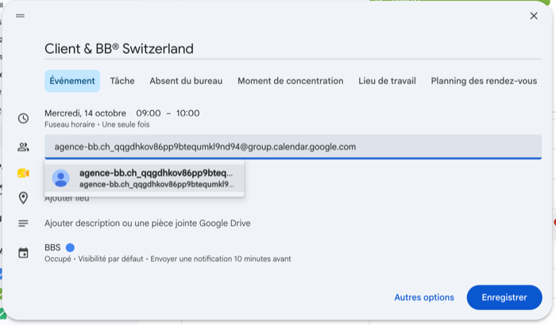
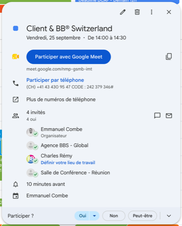

# 📅 Google Agenda

Les agendas partagés de l'agence : **Agenda Global**, **Salle de conférence** et **Bureau ALC**.

## La règle

:::danger Ne crée jamais un événement en tant qu'Agenda Global ou Salle de conférence
Crée-le depuis **ton** agenda, puis **invite** l'agenda concerné.
:::

Ils acceptent automatiquement — la salle de conférence seulement si elle est libre.

## Inviter un agenda

La première fois, colle l'adresse complète dans le champ des invités. Ensuite, tape juste « Global » ou « Salle », Google la retrouve.

| Agenda | Adresse |
|---|---|
| **Agenda Global** | `agence-bb.ch_qqgdhkov86pp9btequmkl9nd94@group.calendar.google.com` |
| **Salle de conférence** | `c_a6da7e2a19696fb08a6cb0b63d2743929fed797e9edeb36f585cf5297ada9370@group.calendar.google.com` |
| **Bureau ALC** | `c_40c3542873b292c31e746abb52de3bf6125c73bc5fba708f67a7a2f0d4db2ea5@group.calendar.google.com` |

Une fois enregistré, l'agenda apparaît dans la liste des invités, au même titre qu'un collègue.

## Nommer les RDV client

**`Nom du client & BB® Switzerland`**
